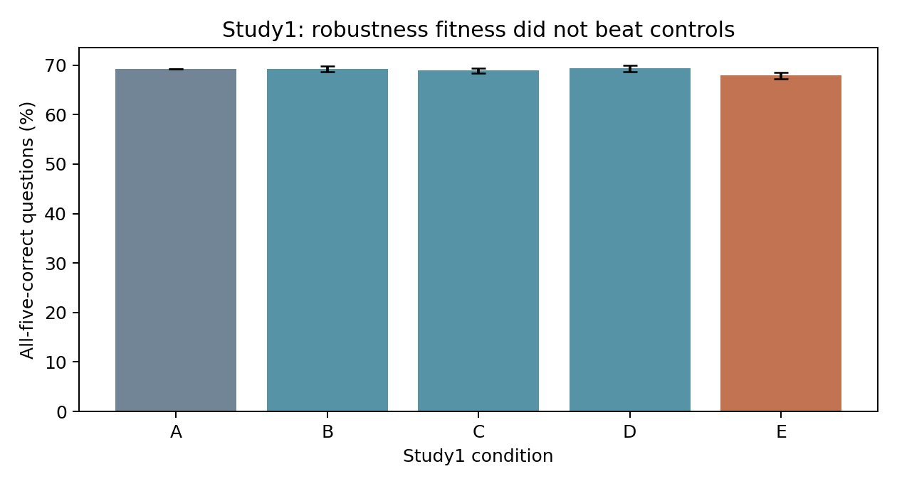
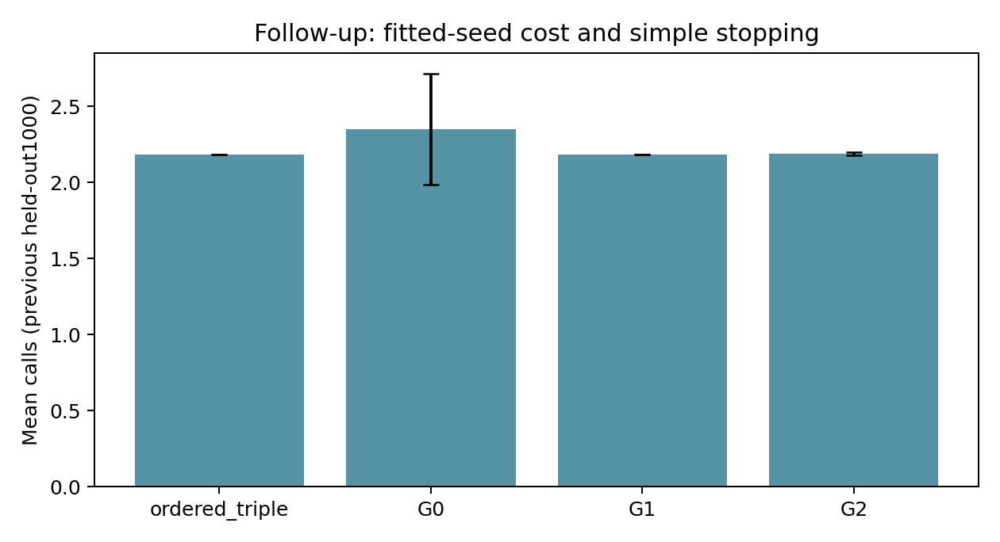
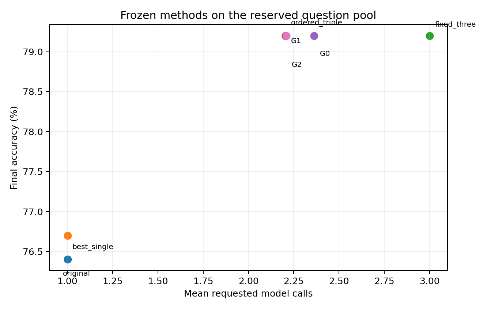
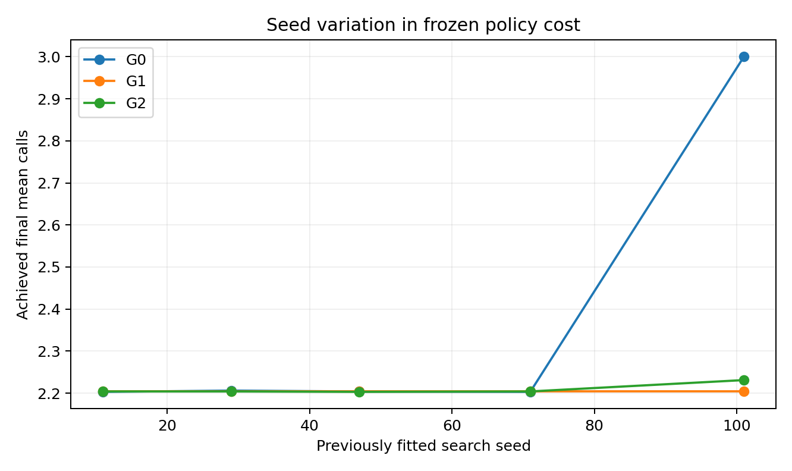

# Evolving Robust Instructions and Adaptive Format Ensembles for LLM Question Answering

DSAI6707 Advanced Computational Intelligence | Individual Research Project | Completed-project report

Course deadline:15 November 2026. The original pre-experiment proposal is preserved verbatim as supplementary material; its earlier personal planning dates do not supersede the course brief.

## Abstract

We study two evolutionary-computation adaptations for a frozen Qwen2.5-3B-Instruct model: all-presentations-correct fitness for instruction evolution, and complementary-error/whole-policy-utility mutation for adaptive presentation-query policies. Study 1's robust objective underperformed random and augmented-average controls on 1109 ARC-Challenge questions. Study 2 and a controlled five-seed repair found no extra benefit from utility guidance over simpler controls. A final frozen evaluation uses1000 newly held-out OpenBookQA training questions, kept unused through subsequent development diagnostics. G2 minus G1 final accuracy is+0.000 percentage points, call difference+0.00520, and utility difference-0.000052. Ordered stopping achieves79.20% at 2.204 calls, versus 79.20% at 3 calls for its fixed triple. Their exact answer vectors are identical. We distinguish ensemble accuracy, stopping efficiency, search consistency and utility guidance; no publication-level novelty or overall capability ceiling is claimed.

## 1. Motivation, questions and research chronology

Equivalent question layouts and option rotations can change a model answer. This creates both a robustness problem and a potential ensemble resource: asking several equivalent versions may recover mistakes, but every call incurs cost. The project asks whether evolution can exploit this structure more effectively than transparent conventional controls.

RQ1: does group-level all-presentations-correct fitness improve evolved instruction robustness beyond random search and average-accuracy fitness? RQ2: can an evolved bounded query policy trade accuracy against requested calls better than fixed subsets, greedy construction and agreement stopping? RQ3: does targeting observed mutation sites or scoring whole-policy utility improve the frozen policies beyond ordinary mutation? The final evaluation assesses these already fitted Study 2 policies; it is not another search.

|Stage|Question pool|Role|
|---|---|---|
|Study 1|ARC search 128, validation 100, pilot 100; final 1109|Initial robustness-fitness hypothesis|
|Study 2|OpenBookQA search 512, validation 489; final 486|Adaptive presentation policies|
|Controlled follow-up|Same development pools; held-out training 1000|Post-result active-node/utility repair|
|Capability diagnostic|Expanded search 1500, reused validation 489; fact subset300|Exploratory bottleneck analysis|
|Retrieval pilot|Same1500/489 and300 controls|Negative diagnostic extension|
|Final extension|Existing reserved training 1000|Frozen core-method comparison|

Table 1. Chronology and distinct roles. Scores across different final pools are not paired improvements.

Both initial studies were completed and inspected before the repair and diagnostics. Those later analyses are explicitly exploratory, not retrospectively presented as the original hypothesis. The final comparisons were finalized after that exploration but before any reserved-question generation. The reserve is an official-training held-out subset, not the official OpenBookQA test split.

## 2. Thematic related work

### 2.1 Representations and the EC–AI connection

Prompt evolution is established: EvoPrompt couples LLM edits with evolutionary operators [1], and Promptbreeder also evolves mutation prompts [2]. EvoLLM studies in-context evolutionary operators [3], while EoH searches natural-language heuristic ideas and executable programs [4]. Eureka optimizes reward code [6], ADAS searches agent programs [7], and model-merging evolution changes model composition [8]. The EC–LLM survey distinguishes both directions of this interaction [9]. These works make an evolutionary wrapper alone an insufficient innovation claim. Our adaptations concern a task-specific fitness and an executable, observable-state policy with controlled mutation ablations. We implement GA-style selection/crossover/mutation and multi-objective accuracy–call selection, rather than asserting use of every course technique such as PSO or DE.

### 2.2 Feedback, credit assignment and controlled operators

OPRO reuses scored histories to propose improvements [10]. DSPy treats LM systems as optimizable programs [11], and MIPRO studies instruction/demo optimization across modules [12]. GEPA uses reflective feedback in evolutionary improvement [5]; TextGrad propagates natural-language critiques [13]. Their strength is richer feedback than a single terminal score; their costs and representations differ substantially. This motivates testing whether search-label complementarity is useful at a query-tree mutation site, while counting every scored probe and supplying a greedy control. A locally correct response need not change the final vote: the utility repair therefore scores the complete edited policy. It remains a narrow ablation of known feedback-guided search ideas, not a general new optimizer or reproduction of these systems.

### 2.3 Presentation sensitivity and useful diversity

FormatSpread establishes sensitivity to meaning-preserving formatting [14]. Generated answers can differ from first-token probability evaluations [15], so our strict letter-generation findings should not be transferred to likelihood scoring. Mixture-of-Agents combines model outputs [18], whereas Self-MoA cautions that source quality can offset diversity [19]. Soft self-consistency uses scoring for varied outputs [20]. Their shared lesson is that disagreement is not itself useful complementarity. A finite-bank oracle is diagnostic, not deployable. Canonical remapping, original single-format controls, exhaustive fixed subsets and simple agreement stopping are therefore necessary to determine whether an evolved ensemble adds practical value.

### 2.4 Adaptive computation, routing and evidence access

RouteLLM learns cost-quality routing from preference data [16], and RouterBench supports cached routing evaluation [17]. Difficulty-dependent test-time compute [21] and reliability-aware self-consistency [22] show that extra computation must be allocated selectively. Earlier adaptive-consistency and FrugalGPT work already establish stopping/cascading[26,27]. Adaptive-RAG and RetrievalQA study when to retrieve[23,24]; our retrieval pilot is diagnostic and adds no adaptive-retrieval novelty. Compared with richer routers, our policies intentionally lack hidden-state confidence and question-semantic features, using only queried canonical predictions and legal observable state. This improves auditability but may restrict headroom. Cached call/token reductions do not establish live latency savings.

The review covers24 relevant2024–2026 public works, with primary-source links and mechanism verification recorded in docs/references.json. Confirmed conference/journal records and author preprints are explicitly separated; older foundations do not count toward24. The course brief does not explicitly require all recent works to be peer-reviewed, and this report makes no such claim. Version/title discrepancies are recorded rather than silently normalized into invented publication records.

## 3. Shared model, transformations and reproducibility

The target model and tokenizer revision is Qwen/Qwen2.5-3B-Instruct aa8e72537993ba99e69dfaafa59ed015b17504d1[30]. No weights are trained. Five predefined formats are original vertical choices, inline choices, bullets, and cyclic rotations by one or two positions. Canonical answer identities are the original option indices0–3. Displayed A–D letters are mapped back before voting or scoring; semantic option text is preserved. Screening excludes missing-media indicators, duplicate options, position references and exact source-question/content overlaps. Automated checks cannot guarantee absence of paraphrases or pretraining exposure.

The fixed Study 2/final manual instruction is: “Solve the science multiple-choice question carefully. Choose the single best answer based on its content, regardless of layout or option order.” The common output contract requests exactly one uppercase displayed option letter. Whitespace is trimmed; other text is invalid. Voting ignores invalid votes, resolves ties to the smallest canonical index and returns explicit failure when all queried answers are invalid. Invalid final answers count incorrect. Tie rules are fixed before final outcomes.

Study 1 used greedy BF16/SDPA target generation in batches of16 with an eight-new-token cap; its local prompt proposer sampled at temperature0.85/top-p0.95 with 160-token cap. Later preparation detected batch-dependent differences. Study 2, its follow-up, diagnostics and this final extension use corrected singleton generation with deterministic Torch settings, TF32 disabled, seed 0 and no input truncation (1536-token input cap). Study 1 results remain preserved and are not recast as singleton evidence. The final cache identity includes exact question/rendering, instruction hash, format/permutation, model/tokenizer revision and decoding configuration.

## 4. Study 1: evolutionary instruction optimization

ARC-Challenge [29] supplies pilot 100/search 128 train questions,100 official-validation questions for selection and1109 screened official-test questions. The five seen formats determine fitness; a table, choices-first layout and reversed order are withheld from search/selection. An identical-input repeat is a separate stability control. Three seeds 11/29/47 share initial populations of four. Every method/seed receives12800 target-evaluation calls, while original-only evaluation can examine more candidates; equal target calls are an imperfect total-compute match because proposal counts/tokens differ.

|Condition|Search representation|Fitness|
|---|---|---|
|A|Manual fixed instruction|No search|
|B|Independent random proposals|All-five-correct|
|C|Elitist genetic prompt search|Original accuracy|
|D|Same genetic framework|Five-format mean accuracy|
|E|Same genetic framework|All-five-correct, proposed|

Table 2. Study 1 controls separate search, augmentation exposure and robust objective.

Local-model mutation/crossover proposes reusable instructions. Rejected, duplicate or malformed proposals and retry costs are recorded. Validation selects among the top three search candidates using the frozen criterion, then selected prompts are evaluated once. Robustness is the fraction of whole question groups correct in every seen presentation; one invalid presentation fails its group. Semantic-flip statistics use valid original/variant pairs and differ from simple displayed-letter changes.

|Condition|Original%|Seen mean%|All-five% ± seedSD|Withheld mean%|
|---|---|---|---|---|
|A|81.97|81.23|69.25 ± 0.00|73.07|
|B|81.54|81.32|69.25 ± 0.59|73.31|
|C|80.97|80.87|68.89 ± 0.55|71.92|
|D|81.39|81.01|69.34 ± 0.68|73.01|
|E|81.24|80.41|67.90 ± 0.65|72.40|

Table 3. Authoritative Study 1 results on 1109 questions; three fitted seeds for B–E, fixed A. SD is between search seeds, not a question interval.

E achieves67.90% all-five-correct versus 69.25% for random search B and69.34% for average-fitness evolution D. The saved paired E−B difference is−1.35 points (conditional95% interval−2.10 to−0.60); E−D is−1.44 points (−2.28 to−0.60). The report retains the negative objective result. Choices-first formatting creates the largest held-out-layout deterioration. Identical-input repeats show some disagreement in this batched phase, so presentation sensitivity is not a pure deterministic model property. Existing audited exact numerators, denominators, seed metrics and repeat diagnostics are preserved as supplementary data, without rerunning the 301953-response audit.

## 5. Study 2: adaptive presentation-query policies

OpenBookQA [28] supplies64 development questions,512 search questions,489 screened official-validation questions and486 screened official-test questions. Earlier ARC outcomes and later inspected OpenBookQA finals are exploratory evidence for any subsequent redesign. The instruction/model/formats are fixed. A binary query tree chooses an unused format or stops; depth≤5, query nodes≤15 and calls≤5. It can observe queried formats, canonical votes, agreement/disagreement, invalid indicators and remaining calls, never labels or unqueried predictions. Aggregation is the frozen canonical vote.

The original random and complementary-error-guided searches use five seeds 11/29/47/71/101, common populations of32 and40 generations. Crossover, representation and multi-objective accuracy-max/calls-min selection are shared. Non-dominated sorting and crowding are NSGA-II-style [25], not a faithful reference implementation: the tournament/front construction is simplified. Guided mutation favors formats rescuing search errors reaching the site when at least12 examples are available, otherwise a declared global-failure fallback. Greedy construction receives comparable search statistics;31 fixed subsets, ten triples, full-five and fixed agreement rules are controls. Validation chooses maximum accuracy under1/2/3-call allowances, then cost/size/hash; achieved final costs need not exactly equal an allowance.

|Method|Accuracy%|Mean calls|Mean tokens|
|---|---|---|---|
|single|80.25|1.000|101.8|
|fixed_three|81.69|3.000|305.4|
|fixed_full|79.01|5.000|516.0|
|fixed_subset|81.69|3.000|305.4|
|agreement|77.57|2.084|215.4|
|greedy|81.69|2.253|229.1|
|random|81.65|2.218|226.2|
|guided|81.60|2.585|263.6|

Table 4. Original Study 2 primary three-call-allowance results on 486 official-test questions. Five-seed methods are averaged; cross-pool differences are not repair gains.

Original rescue guidance has no observed advantage: mean accuracy 81.60% at 2.585 calls versus ordinary mutation 81.65% at 2.218. Full-five voting is worse than the selected fixed triple. These results motivated a controlled post-result repair; they did not justify claiming guidance won. A finite response bank can have oracle coverage without an observable rule identifying its correct answers.

## 6. Controlled active-node and utility follow-up

The follow-up reuses the 512/489 development pools and freezes policies before a different1000-question held-out TRAIN subset, now already inspected. G0 preserves ordinary mutation over all sites. G1 samples only sites observed on search questions, without pruning zero-visit branches. G2 uses the same active-site rule and scores up to eight distinct whole-policy trial edits with U=accuracy−0.01×mean_calls, selecting by utility/cost/size/hash, with 20% random exploration. G3 retains the original rescue heuristic; a utility hill-climber uses comparable trial statistics without evolutionary population/crossover. All five seeds share initial populations and4096 full-search-policy evaluation equivalents each. Every scored base, trial, discarded probe and duplicate is charged. Equal evaluations do not imply equal offspring: G2 can inspect fewer offspring due to lookahead.

G2 changes bounded trial construction as well as trial ranking, so G2−G1 is an ablation of the whole informed proposal mechanism, not a perfectly isolated scorer change. Guidance uses search labels only. Frozen validation selection is the same accuracy-under-allowance rule. The new simple control enumerates all 60 ordered triples, stopping only on valid agreement of the first two responses.

|Method|Accuracy%|Calls ± seedSD|Mean tokens|
|---|---|---|---|
|fixed_three|83.30|3.0000 ± 0.0000|303.7|
|ordered_triple|83.30|2.1800 ± 0.0000|220.6|
|legacy_greedy|83.40|2.2610 ± 0.0000|228.9|
|G0|83.30|2.3480 ± 0.3645|237.8|
|G1|83.30|2.1800 ± 0.0000|220.6|
|G2|83.30|2.1864 ± 0.0097|221.4|
|G3|83.30|2.1882 ± 0.0091|221.6|
|hill|83.30|2.2124 ± 0.0724|223.9|

Table 5. Prior controlled follow-up on its own1000-question final pool. These are not the newly reserved final results.

Active-site mutation changed the intended search mechanism: G0 placed81.6% of mutations at sites with no observed search visits, versus 0% for G1/G2. Prediction-changing edits rose from 10.1% for G0 to55.9% for G1. A consequential edit is not necessarily beneficial, and zero observed visits do not prove logical unreachability. G2 spent more probes per offspring and added no observed final gain. G1, G2 and the selected ordered triple produced exactly the same answers in every fitted seed on this earlier pool, while calls differed. The G0 mean cost difference was largely driven by one seed retaining a three-call policy. Mechanism improvement and search-cost consistency are distinguished from utility-guidance effectiveness.

## 7. Concise capability and retrieval diagnostics

After inspecting the follow-up, development search expanded to1500 questions while validation stayed489. The currently evaluated1000-question reserve was selected first and left unqueried throughout. The old frozen reference got395/489 correct; the original five-response bank contained a correct answer for446. Its94 errors partition exactly into51 with another correct response and43 with none. This is a finite-bank selector upper bound, not deployable performance or a global model capability ceiling.

A shared L2-regularized candidate scorer used only format support, votes, pair supports and invalid interactions, with five-fold whole-question CV confined to search. Five nested subset draws at 128/256/512/1000/1500 search questions reused the same validation pool. From512 to1500, mean validation gains were only0.25 points for the three-response scorer and0.53 for five responses; at 1500 they scored80.57%/three calls and80.37%/five calls, below the 80.78%/2.207-call reference. Subset variation is not independent validation replication and does not establish an evolutionary learning curve.

Three fixed original-layout strategy prompts were tested on search; a prewritten search-only rule selected elimination and principle-first for validation. They scored66.87% and65.44%, versus 77.91% for the original single. About93% of their validation errors were valid parsed wrong answers, not formatting failures; neither produced truncations. On300 fixed search questions, supplying the annotated supporting fact increased original accuracy 80→84%, compared with 79.33% for unrelated context. This was privileged evidence. The stronger reference scored81.67% on those same300; its comparison with 84% remained uncertain.

The bounded deployable retrieval pilot indexed1326 official public science facts using fixed BM25 and a symmetric stem-plus-options query. Search selected top-one retrieval before all fixed validation conditions. It scored373/489 (76.28%), versus 381/489 (77.91%) for the same-wrapper empty-evidence control and395/489 (80.78%) for ordered stopping. Top three scored380/489 (77.71%). Both retrieval conditions requested more tokens than the original one-call baseline without improving its accuracy. All annotations were in the corpus, but hit@1 was31.9% and hit@3 44.8%; matching a fact did not guarantee correct use. This negative extension motivates no automatic routing search, and contributes no evidence that evolution helps. Detailed diagnostic/control tables belong in the appendix.

## 8. Final reserved-pool evaluation: frozen Study 2 extension

The exact existing reserve contains1000 eligible OpenBookQA training questions, dataset revision388097ea7776314e93a529163e0fea805b8a6454, reservation seed 301030. Its canonical manifest hash is361ca31dacce2c25e79fcdca6af149cb64f3eec1168053cfd9263b4576df5ddb. Pre-inference checks compare known IDs, normalized stems and unordered option content against prior splits, query inventories and scoring records. Existing audited historical inventories are reused, rather than re-auditing hundreds of thousands of predictions. The same semantic-preservation rules pass all 1000; no post-outcome exclusion or replacement pool is permitted.

Frozen methods are original format, development-selected best single (rotate2), the archived fixed triple using the same formats as ordered stopping, the archived ordered triple (rotate2, rotate1, original), and all five archived G0/G1/G2 policies at the primary three-call validation allowance. Exact exports come from followup_active_utility/runs/main/FROZEN.json and its matching selected_policies.json. No cheapest/best seed is chosen. The selected exports reproduce saved validation statistics and prior answer/cost vectors before final generation.

The primary methodological comparison is G2−G1 for accuracy, requested calls and U=accuracy−0.01×mean_calls. The primary practical comparison is ordered stopping−fixed triple, including exact answer equality and requested calls/tokens. Secondary comparisons are G1−G0, ordered stopping−original/best single, and G1/G2−ordered stopping. A three-call validation allowance is not an exact final cost constraint. Sources, prompt/renderers, exports, revisions, pool, metrics and2000-replicate bootstrap seed 301050 are hashed and timestamped before the first reserved response. One five-format matrix (5000 main calls) is reused by every policy.

Whole-question paired bootstrap retains all format responses and all five fitted seeds inside each sampled question. For seed-averaged differences, fitted-seed outcomes are averaged within question before resampling; seed SD and per-seed contrasts are separate. Intervals condition on these fitted policies and do not include uncertainty from every possible future search. Accuracy differences are percentage points; relative call/token reductions are percentages. Overlap of separate intervals is not a test, and failure to detect a difference does not establish equivalence or non-inferiority.

### 8.1 Final achieved metrics

|Method|Accuracy% ± seedSD|Calls ± seedSD|Mean input/output tokens|Invalid%|
|---|---|---|---|---|
|original|76.40 ± 0.00|1.0000 ± 0.0000|98.8/2.0|0.00|
|best_single|76.70 ± 0.00|1.0000 ± 0.0000|98.8/2.0|0.10|
|fixed_three|79.20 ± 0.00|3.0000 ± 0.0000|296.3/6.0|0.00|
|ordered_triple|79.20 ± 0.00|2.2040 ± 0.0000|217.7/4.4|0.00|
|G0|79.20 ± 0.00|2.3632 ± 0.3560|233.4/4.7|0.00|
|G1|79.20 ± 0.00|2.2040 ± 0.0000|217.7/4.4|0.00|
|G2|79.20 ± 0.00|2.2092 ± 0.0122|218.2/4.4|0.00|

Table 6. Final reserved 1000-question results. SD is across fitted search seeds, not across seed–question pseudo-replicates. Exact correct counts and all five seeds are in Table 7/CSV.

|Method/seed|Correct/N|Calls|U|Tokens|
|---|---|---|---|---|
|original|764/1000|1.0000|0.754000|100.8|
|best_single|767/1000|1.0000|0.757000|100.8|
|fixed_three|792/1000|3.0000|0.762000|302.3|
|ordered_triple|792/1000|2.2040|0.769960|222.1|
|G0/seed 11|792/1000|2.2030|0.769970|222.0|
|G0/seed 29|792/1000|2.2060|0.769940|222.3|
|G0/seed 47|792/1000|2.2040|0.769960|222.1|
|G0/seed 71|792/1000|2.2030|0.769970|222.0|
|G0/seed 101|792/1000|3.0000|0.762000|302.3|
|G1/seed 11|792/1000|2.2040|0.769960|222.1|
|G1/seed 29|792/1000|2.2040|0.769960|222.1|
|G1/seed 47|792/1000|2.2040|0.769960|222.1|
|G1/seed 71|792/1000|2.2040|0.769960|222.1|
|G1/seed 101|792/1000|2.2040|0.769960|222.1|
|G2/seed 11|792/1000|2.2040|0.769960|222.1|
|G2/seed 29|792/1000|2.2040|0.769960|222.1|
|G2/seed 47|792/1000|2.2030|0.769970|222.0|
|G2/seed 71|792/1000|2.2040|0.769960|222.1|
|G2/seed 101|792/1000|2.2310|0.769690|224.9|

Table 7. Every fitted seed is retained; no seed is selected using any final pool.

|Method|1 call%|2 calls%|3 calls%|4 calls%|5 calls%|
|---|---|---|---|---|---|
|original|100.0|0.0|0.0|0.0|0.0|
|best_single|100.0|0.0|0.0|0.0|0.0|
|fixed_three|0.0|0.0|100.0|0.0|0.0|
|ordered_triple|0.0|79.6|20.4|0.0|0.0|
|G0|0.0|63.7|36.3|0.0|0.0|
|G1|0.0|79.6|20.4|0.0|0.0|
|G2|0.0|79.1|20.9|0.0|0.0|

Table 7b. Distribution of requested calls; stochastic rows average fitted-seed percentages within this same question pool.

|Role/comparison|Accuracy Δ points [95%]|Calls Δ [95%]|U Δ [95%]|
|---|---|---|---|
|primary_methodological: G2 − G1|+0.000 [+0.000,+0.000]|+0.00520 [-0.00400,+0.01380]|-0.000052 [-0.000138,+0.000040]|
|primary_practical: ordered_triple − fixed_three|+0.000 [+0.000,+0.000]|-0.79600 [-0.82100,-0.77000]|+0.007960 [+0.007700,+0.008210]|
|secondary: G1 − G0|+0.000 [+0.000,+0.000]|-0.15920 [-0.17320,-0.14440]|+0.001592 [+0.001444,+0.001732]|
|secondary: ordered_triple − original|+2.800 [+0.900,+4.600]|+1.20400 [+1.17900,+1.23000]|+0.015960 [-0.003101,+0.033831]|
|secondary: ordered_triple − best_single|+2.500 [+0.600,+4.400]|+1.20400 [+1.17900,+1.23000]|+0.012960 [-0.005901,+0.032030]|
|secondary: G1 − ordered_triple|+0.000 [+0.000,+0.000]|+0.00000 [+0.00000,+0.00000]|+0.000000 [+0.000000,+0.000000]|
|secondary: G2 − ordered_triple|+0.000 [+0.000,+0.000]|+0.00520 [-0.00400,+0.01380]|-0.000052 [-0.000138,+0.000040]|

Table 8. Whole-question paired bootstrap, conditional on fitted policies. Token/input/output/invalid differences are in the supplied full-precision tables.

G0 versus ordered stopping: 0 answer-vector differences summed across the five fitted seeds (descriptive, not independent sample size). Every fitted seed produces exactly the same canonical answer vector as the simple control.

G1 versus ordered stopping: 0 answer-vector differences summed across the five fitted seeds (descriptive, not independent sample size). Every fitted seed produces exactly the same canonical answer vector as the simple control.

G2 versus ordered stopping: 0 answer-vector differences summed across the five fitted seeds (descriptive, not independent sample size). Every fitted seed produces exactly the same canonical answer vector as the simple control.

Matched-seed G2 versus G1: 0 canonical answer differences summed over five fitted seeds. Their final predictions are exactly identical for every matched seed, not merely equal rounded accuracy.

Matched-seed G2 versus G0: 0 canonical answer differences summed over five fitted seeds. Their final predictions are exactly identical for every matched seed, not merely equal rounded accuracy.

Primary G2−G1: accuracy+0.000 points, calls+0.00520, U-0.000052. No observed accuracy gain is present; any utility difference must be interpreted with achieved cost.

Primary ordered−fixed comparison: exact answer differences=0; relative call reduction=26.53% and relative total-token reduction=26.53%. Two valid agreeing votes cannot be overturned by one further vote under the frozen rule. This is stopping efficiency, not an additional ensemble accuracy gain.

Actual final matrix: 5000 calls, 500784 input tokens, 10001 output tokens; generation11.52 minutes. Raw invalid responses=1; truncations=0. These physical experiment calls are not the mean requests of an individual deployment policy.

## 9. Discussion, limitations and contribution

The project connects to genetic search through population initialization, mutation, crossover and selection, and to multi-objective evolutionary optimization through accuracy–cost Pareto survival. The tested adaptations are a group-robustness fitness, complementary-error proposals, observed-state mutation locations and full-policy utility lookahead. This exceeds a bare off-the-shelf optimizer application, while the empirical conclusions remain bounded and can be negative. Neither ensembling, agreement stopping, semantic feedback nor adaptive retrieval is claimed novel.

Keep four mechanisms separate. Ensembling may change final answers. Stopping may preserve exactly those answers while saving requests. Active-node mutation may reduce wasted edits and improve consistency across the fitted searches. Utility guidance needs its own additional benefit beyond those controls; more consequential changes or more inspected trials are insufficient evidence. A negative operator ablation is useful evidence about this design, not proof that evolution or utility search cannot work generally.

Limitations include one small model and finite format pool; filtered public benchmarks; imperfect semantic screening and pretraining-overlap detection; different batched/singleton settings across historical phases; repeated development-validation inspection; a post-result repair; limited three/five fitted search seeds; approximate achieved costs rather than exact matching; G2 proposal-distribution confounds; and conditional rather than retraining-inclusive bootstrap intervals. The untouched final pool addresses known development exposure for this frozen comparison, not all researcher degrees of freedom. A correct annotation need not be complete evidence, and generated rationales do not reveal internal causes.

## 10. Reproducibility, costs and completion

The executable run script resolves its environment, one GPU, config, logging and resume paths. A launcher lock and workflow lock prevent duplicates. Singleton raw responses and durable attempts are saved after every call; cache keys include exact rendered input, instruction, permutation, model/tokenizer revision and decoding. Resume retains the same manifests and policies and rejects incompatible source/config/package changes. Complete means a full unique1000×5 matrix, consistent hashes, legal no-repeat policies, all methods on the same question IDs, reproduced replays and generated report/package artifacts. Interrupted unknown physical attempts are disclosed separately.

|Phase|New recorded calls|Input/output tokens|Generation minutes|
|---|---|---|---|
|Study 1 target|301953|44,005,580/604,106|96.65|
|Study 1 proposer|442|126,021/23,400|29.80|
|Study 2|7435|753,337/14,880|17.96|
|Follow-up|5000|503,131/10,007|12.25|
|Capability|11082|1,335,887/123,066|144.47|
|Retrieval|6267|957,833/12,613|15.44|

Table 9. Actual recorded main-generation costs by phase, excluding reused calls and separate preparation extras. Batched Study 1 timing is not directly comparable with singleton deployment.

Original Study 2 search wall timers sum to20.54 seconds. The controlled follow-up records3440.30 search wall seconds and284.01 process-CPU seconds; durable per-evaluation checkpoint I/O accounts for much of the difference. Study 1 has stage wall timings but no isolated search process-CPU timer; that legacy statistic is unavailable and is not invented. Final replay CPU/wall and matrix generation costs are measured separately in analysis/costs.json.

Actual full-matrix calls/tokens/runtime are distinct from simulated deployment calls/tokens requested by a policy and from CPU replay/document costs. Historical target/proposer/search costs are preserved separately. A full prediction cache does not by itself establish live latency savings. Ten short development-only smoke calls are extra preparation inference and do not consume the reserved pool. Model experiments and method tuning end after this final evaluation; no new search, prompts, retrieval or inference is launched from report generation.

The submission package contains complete source/configuration, processed/raw results supporting the tables, primary-source literature records, frozen policies/manifests, figures, exact commands and a course-brief checklist. The original proposal remains unchanged; a separate one-page completed-project summary describes actual results. Nothing is submitted or published externally. Author identification/final editorial reading and the actual course upload remain the student’s tasks.

## 11. Conclusion

Study 1's proposed robust objective did not improve over its controls. Study 2 and its controlled repair exposed the importance of simple stopping controls and useful mutation locations, without assuming an advantage for utility guidance. In the final frozen comparison, G2−G1 is+0.000 accuracy points,+0.00520 calls and-0.000052 utility. Ordered stopping saves26.53% of fixed-triple calls, with 0 different final answers. These are results for this model, pool and fitted methods, not a capability ceiling or universal evolutionary superiority claim.

## Appendix A. Full precision, search seeds and diagnostic controls

Per-seed metrics, question-paired predictions, call distributions, exact vector comparisons, raw responses, request identities, attempts, masks/costs and all paired intervals are supplied as CSV/JSON/SQLite. Printed tables round for readability; underlying values come directly from authoritative outputs, never reconstructed from rounded chat summaries.

|Diagnostic condition|Validation correct/N|Accuracy%|Calls|
|---|---|---|---|
|frozen_ordered_triple|395/489|80.78|2.207|
|original|381/489|77.91|1.000|
|elimination|327/489|66.87|1.000|
|principle|320/489|65.44|1.000|
|five_plus_selected_selector|395/489|80.78|7.000|
|reference_three_selector|394/489|80.57|3.000|
|all_five_selector|393/489|80.37|5.000|

TableA1. Capability diagnostic on reused489 validation questions.

|Retrieval condition|Correct/N|Accuracy%|Mean tokens|
|---|---|---|---|
|original|381/489|77.91|103.0|
|ordered_triple|395/489|80.78|226.9|
|full_five|384/489|78.53|521.8|
|R0|381/489|77.91|140.0|
|R1|373/489|76.28|152.4|
|R3|380/489|77.71|177.5|

TableA2. Fixed retrieval-pilot conditions; R1 was selected on search, not replaced by the validation winner.

Course brief mapping: sections1–2 cover problem/motivation and a thematic review of24 recent works; sections3–6 describe the EC–AI adaptation and controlled baselines; sections7–8 separate exploratory diagnostics from final held-out assessment; sections9–10 address evidence-based interpretation, limitations and reproducibility. Source, results and supplementary materials are enumerated in submission/SUBMISSION_CHECKLIST.md.

## References

[1] Qingyan Guo, Rui Wang, Junliang Guo, Bei Li, Kaitao Song, Xu Tan, Guoqing Liu, Jiang Bian, Yujiu Yang (2024). Connecting Large Language Models with Evolutionary Algorithms Yields Powerful Prompt Optimizers (EvoPrompt). ICLR 2024; preprint first2023. [Primary source](https://proceedings.iclr.cc/paper_files/paper/2024/hash/9156b0f6dfa9bbd18c79cc459ef5d61c-Abstract-Conference.html). ArXiv title begins EvoPrompt; proceedings title differs.

[2] Chrisantha Fernando, Dylan Sunil Banarse, Henryk Michalewski, Simon Osindero, Tim Rocktäschel (2024). Promptbreeder: Self-Referential Self-Improvement via Prompt Evolution. ICML 2024, PMLR 235:13481–13544. [Primary source](https://proceedings.mlr.press/v235/fernando24a.html). 

[3] Robert Tjarko Lange, Yingtao Tian, Yujin Tang (2024). Large Language Models As Evolution Strategies. arXiv preprint 2402.18381; no venue asserted. [Primary source](https://arxiv.org/abs/2402.18381). Preprint status retained; not counted as confirmed peer-reviewed publication.

[4] Fei Liu, Xialiang Tong, Mingxuan Yuan, Xi Lin, Fu Luo, Zhenkun Wang, Zhichao Lu, Qingfu Zhang (2024). Evolution of Heuristics: Towards Efficient Automatic Algorithm Design Using Large Language Model. ICML 2024, PMLR 235:32201–32223. [Primary source](https://proceedings.mlr.press/v235/liu24bs.html). PMLR metadata inverts Xialiang Tong; author preprint uses Xialiang Tong.

[5] Lakshya A Agrawal, Shangyin Tan, Dilara Soylu, Noah Ziems, Rishi Khare, Krista Opsahl-Ong, Arnav Singhvi, Herumb Shandilya, Michael J Ryan, Meng Jiang, Christopher Potts, Koushik Sen, Alexandros G. Dimakis, Ion Stoica, Dan Klein, Matei Zaharia, Omar Khattab (2025). GEPA: Reflective Prompt Evolution Can Outperform Reinforcement Learning. arXiv 2507.19457v2, revised14February2026; no venue asserted. [Primary source](https://arxiv.org/abs/2507.19457v2). Title is a paper claim, not our empirical claim; no numerical superiority transferred here.

[6] Yecheng Jason Ma, William Liang, Guanzhi Wang, De-An Huang, Osbert Bastani, Dinesh Jayaraman, Yuke Zhu, Linxi Fan, Anima Anandkumar (2024). Eureka: Human-Level Reward Design via Coding Large Language Models. ICLR 2024, confirmed author primary record; preprint 2023. [Primary source](https://arxiv.org/abs/2310.12931). 

[7] Shengran Hu, Cong Lu, Jeff Clune (2024). Automated Design of Agentic Systems. Author preprint 2408.08435, revised2025; ICLR 2025 per existing review, venue not needed for recent-year count. [Primary source](https://arxiv.org/abs/2408.08435). Counted by verified2024 public preprint date; avoid unverified venue dependence.

[8] Takuya Akiba, Makoto Shing, Yujin Tang, Qi Sun, David Ha (2025). Evolutionary optimization of model merging recipes. Nature Machine Intelligence7:195–204, published27January2025. [Primary source](https://www.nature.com/articles/s42256-024-00975-8). 

[9] Xingyu Wu, Sheng-hao Wu, Jibin Wu, Liang Feng, Kay Chen Tan (2024). Evolutionary Computation in the Era of Large Language Model: Survey and Roadmap. Author preprint 2401.10034; IEEE TEC29(2):534–554,2025 per course brief. [Primary source](https://arxiv.org/abs/2401.10034). Primary preprint and authoritative course citation distinguished.

[10] Chengrun Yang, Xuezhi Wang, Yifeng Lu, Hanxiao Liu, Quoc V. Le, Denny Zhou, Xinyun Chen (2024). Large Language Models as Optimizers. ICLR 2024 confirmed author record; preprint 2023. [Primary source](https://arxiv.org/abs/2309.03409). 

[11] Omar Khattab, Arnav Singhvi, Paridhi Maheshwari, Zhiyuan Zhang, Keshav Santhanam, Sri Vardhamanan, Saiful Haq, Ashutosh Sharma, Thomas T. Joshi, Hanna Moazam, Heather Miller, Matei Zaharia, Christopher Potts (2024). DSPy: Compiling Declarative Language Model Calls into Self-Improving Pipelines. ICLR 2024 primary proceedings/PDF. [Primary source](https://proceedings.iclr.cc/paper_files/paper/2024/hash/f1cf02ce09757f57c3b93c0db83181e0-Abstract-Conference.html). Proceedings web title says State-of-the-Art Pipelines; conference PDF/preprint says Self-Improving Pipelines.

[12] Krista Opsahl-Ong, Michael J Ryan, Josh Purtell, David Broman, Christopher Potts, Matei Zaharia, Omar Khattab (2024). Optimizing Instructions and Demonstrations for Multi-Stage Language Model Programs. EMNLP 2024. [Primary source](https://aclanthology.org/2024.emnlp-main.525/). 

[13] Mert Yuksekgonul, Federico Bianchi, Joseph Boen, Sheng Liu, Zhi Huang, Carlos Guestrin, James Zou (2024). TextGrad: Automatic Differentiation via Text. Author preprint 2406.07496; journal version Optimizing generative AI by backpropagating language model feedback, Nature 639:609–616,2025. [Primary source](https://arxiv.org/abs/2406.07496). Journal title differs; publisher landing-page search record checked, direct fetch blocked by cookies; primary preprint is accessible.

[14] Melanie Sclar, Yejin Choi, Yulia Tsvetkov, Alane Suhr (2024). Quantifying Language Models’ Sensitivity to Spurious Features in Prompt Design or: How I learned to start worrying about prompt formatting. ICLR 2024 camera-ready author record; preprint 2023. [Primary source](https://arxiv.org/abs/2310.11324). 

[15] Xinpeng Wang, Chengzhi Hu, Bolei Ma, Paul Röttger, Barbara Plank (2024). Look at the Text: Instruction-Tuned Language Models are More Robust Multiple Choice Selectors than You Think. COLM 2024 confirmed author record. [Primary source](https://arxiv.org/abs/2404.08382). 

[16] Isaac Ong, Amjad Almahairi, Vincent Wu, Wei-Lin Chiang, Tianhao Wu, Joseph E. Gonzalez, M Waleed Kadous, Ion Stoica (2024). RouteLLM: Learning to Route LLMs with Preference Data. Author preprint 2406.18665, revised23February2025; no venue asserted. [Primary source](https://arxiv.org/abs/2406.18665). Preprint/publication status is not conflated.

[17] Qitian Jason Hu, Jacob Bieker, Xiuyu Li, Nan Jiang, Benjamin Keigwin, Gaurav Ranganath, Kurt Keutzer, Shriyash Kaustubh Upadhyay (2024). RouterBench: A Benchmark for Multi-LLM Routing System. Author preprint 2403.12031. [Primary source](https://arxiv.org/abs/2403.12031). No conference status asserted.

[18] Junlin Wang, Jue Wang, Ben Athiwaratkun, Ce Zhang, James Zou (2024). Mixture-of-Agents Enhances Large Language Model Capabilities. Author preprint 2406.04692. [Primary source](https://arxiv.org/abs/2406.04692). No conference status asserted.

[19] Wenzhe Li, Yong Lin, Mengzhou Xia, Chi Jin (2025). Rethinking Mixture-of-Agents: Is Mixing Different Large Language Models Beneficial?. Author preprint 2502.00674. [Primary source](https://arxiv.org/abs/2502.00674). No numerical gain from another model family is assumed here.

[20] Han Wang, Archiki Prasad, Elias Stengel-Eskin, Mohit Bansal (2024). Soft Self-Consistency Improves Language Model Agents. ACL 2024 short papers. [Primary source](https://aclanthology.org/2024.acl-short.28/). ACL web metadata says Models Agents; paper title uses Model Agents.

[21] Charlie Snell, Jaehoon Lee, Kelvin Xu, Aviral Kumar (2024). Scaling LLM Test-Time Compute Optimally can be More Effective than Scaling Model Parameters. Author preprint 2408.03314. [Primary source](https://arxiv.org/abs/2408.03314). No venue asserted or headline numerical result transferred.

[22] Junseok Kim, Nakyeong Yang, Kyungmin Min, Kyomin Jung (2026). Reliability-Aware Adaptive Self-Consistency for Efficient Sampling in LLM Reasoning. Findings of ACL 2026:21575–21590, DOI10.18653/v1/2026.findings-acl.1085. [Primary source](https://aclanthology.org/2026.findings-acl.1085/). Proceedings status checked rather than relying only on author preprint.

[23] Soyeong Jeong, Jinheon Baek, Sukmin Cho, Sung Ju Hwang, Jong Park (2024). Adaptive-RAG: Learning to Adapt Retrieval-Augmented Large Language Models through Question Complexity. NAACL 2024. [Primary source](https://aclanthology.org/2024.naacl-long.389/). 

[24] Zihan Zhang, Meng Fang, Ling Chen (2024). RetrievalQA: Assessing Adaptive Retrieval-Augmented Generation for Short-form Open-Domain Question Answering. Findings of ACL 2024. [Primary source](https://aclanthology.org/2024.findings-acl.415/). 

[25] Kalyanmoy Deb, Amrit Pratap, Sameer Agarwal, T. Meyarivan (2002). A fast and elitist multiobjective genetic algorithm: NSGA-II. IEEE TEC6:182–197. DOI10.1109/4235.996017. [Primary record](https://www.egr.msu.edu/~kdeb/reports.shtml). Older foundations/assets are excluded from the 24 recent-paper count.

[26] Pranjal Aggarwal, Aman Madaan, Yiming Yang, Mausam (2023). Let’s Sample Step by Step: Adaptive-Consistency for Efficient Reasoning and Coding with LLMs. EMNLP 2023. [Primary record](https://arxiv.org/abs/2305.11860). Older foundations/assets are excluded from the 24 recent-paper count.

[27] Lingjiao Chen, Matei Zaharia, James Zou (2023). FrugalGPT: How to Use Large Language Models While Reducing Cost and Improving Performance. Author preprint. [Primary record](https://arxiv.org/abs/2305.05176). Older foundations/assets are excluded from the 24 recent-paper count.

[28] Todor Mihaylov, Peter Clark, Tushar Khot, Ashish Sabharwal (2018). Can a Suit of Armor Conduct Electricity? A New Dataset for Open Book Question Answering. EMNLP 2018. [Primary record](https://arxiv.org/abs/1809.02789). Older foundations/assets are excluded from the 24 recent-paper count.

[29] Peter Clark et al. (2018). Think you have Solved Question Answering? Try ARC, the AI2 Reasoning Challenge. Dataset primary paper. [Primary record](https://arxiv.org/abs/1803.05457). Older foundations/assets are excluded from the 24 recent-paper count.

[30] Qwen team. Qwen2.5-3B-Instruct official model card; pinned model/tokenizer revision recorded in the experiment. [Primary record](https://huggingface.co/Qwen/Qwen2.5-3B-Instruct). Older foundations/assets are excluded from the 24 recent-paper count.
