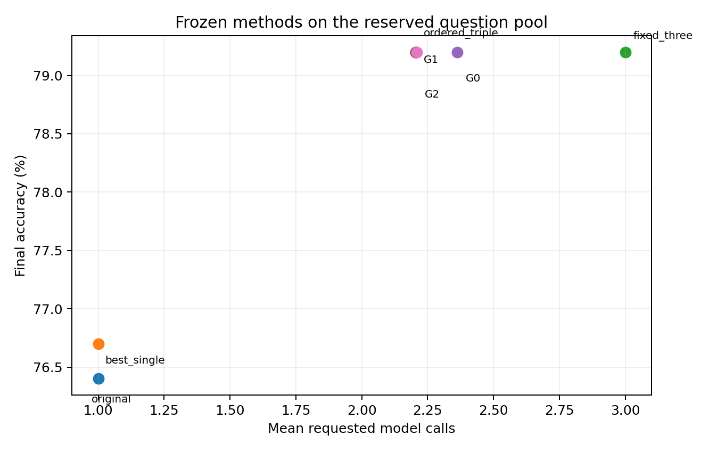

# All completed experiments

This guide records the DSAI6707 experiments in chronological order. It distinguishes initial hypotheses, post-result changes, exploratory diagnostics and the last frozen evaluation. Numbers come from saved full-precision outputs, rounded here for readability.

**Main finding:** ensembling sometimes improved accuracy and agreement stopping saved requests. Tested guidance did not outperform the strongest simple control. Active-node mutation made edits more consequential and found efficient policies more consistently across the fitted searches. These results do not establish a global capability ceiling or a general failure of evolution.

## Reading this record

This is one course project with two main studies. Stages 3–6 extend or diagnose Study 2. The later mechanism work reuses saved records and is not another model experiment. Use [Results explained](guides/RESULTS.md) for a shorter interpretation and [the repository map](guides/REPOSITORY_MAP.md) for file locations.

- [1. Instruction robustness](#1-instruction-optimization-for-presentation-robustness)
- [2. Adaptive presentation policies](#2-adaptive-presentation-query-policies)
- [3. Controlled mutation follow-up](#3-controlled-active-node-and-utility-guided-follow-up)
- [4. Capability diagnostic](#4-bounded-capability-diagnostic)
- [5. Retrieval pilot](#5-bounded-retrieval-pilot)
- [6. Final frozen evaluation](#6-final-frozen-reserved-pool-evaluation)
- [Later CPU mechanism analyses](#post-hoc-cpu-mechanism-analyses)
- [Preparation and failed attempts](#preparation-failed-attempts-and-verification)

## Shared setup

| Item | Setup |
|---|---|
| Model | `Qwen/Qwen2.5-3B-Instruct` |
| Model revision | `aa8e72537993ba99e69dfaafa59ed015b17504d1` |
| OpenBookQA revision | `388097ea7776314e93a529163e0fea805b8a6454` |
| Later five-format pool | Original, inline, bullets, rotate options by one, rotate by two |
| Canonical answers | Remap displayed letters to original option identities before voting/scoring |
| Standard parser | Exactly one uppercase displayed A–D after whitespace trimming |
| Voting | Ignore invalid votes; lowest canonical index breaks ties; all-invalid is an explicit failure |
| Standard decoding | Greedy BF16/SDPA, eight-new-token cap |
| Batch distinction | Study 1 used batches of 16; Study 2 onward used corrected singleton generation |
| Search seeds | Study 1: 11/29/47; later evolutionary comparisons: 11/29/47/71/101 |

Study 2 and subsequent standard-format policies share one manual instruction:

> Solve the science multiple-choice question carefully. Choose the single best answer based on its content, regardless of layout or option order.

The output contract requests exactly one displayed uppercase option letter. Study 1 instead optimizes instructions. Later reasoning/retrieval probes use explicitly controlled prompt variants; policies never choose between optimized instructions.

Policies see only queried formats, predictions, votes, agreement, invalid indicators and remaining calls. They cannot access gold labels or unqueried responses at inference. Search labels guide fitting; validation selects operating points. Final outcomes do not guide fitting or selection.

Requested policy calls/tokens are simulated deployment costs from replay. Actual cache generation and CPU search costs are separate. Cached request savings do not establish equal live-latency savings.

## 1. Instruction optimization for presentation robustness

**Question:** can genetic instruction search improve answering correctly in every equivalent presentation?

**Code:** [old_idea/robust_prompt/](old_idea/robust_prompt/). **Configuration:** [old_idea/configs/](old_idea/configs/).

Screened ARC-Challenge pools: pilot 100, search 128, validation 100, final 1,109. Five seen formats define fitness; three additional layouts test transfer. Identical-input repeats test stability separately. These inspected final questions later became exploratory evidence for the pivot.

Three seeds share an initial population of four and a 12,800 target-evaluation-call budget per method/seed. A local LLM proposes mutation/crossover edits.

| Condition | Correct in all five seen formats |
|---|---:|
| A: manual instruction | 69.25% |
| B: independent random proposals, robust fitness | 69.25% |
| C: evolution, original-format accuracy | 68.89% |
| D: evolution, five-format mean accuracy | 69.34% |
| E: evolution, proposed all-five-correct fitness | 67.90% |

**Result:** proposed robust fitness underperformed. E−B was −1.35 percentage points, paired 95% interval [−2.10, −0.60]; E−D was −1.44 points [−2.28, −0.60]. All-five-correct is stricter than ordinary accuracy. Batched identical-input repeats sometimes disagreed, limiting causal attribution to layout alone.

**Evidence:** [statistics](old_idea/runs/main/analysis/statistics.json), [metrics](old_idea/runs/main/analysis/metrics.csv), [seeds](old_idea/runs/main/analysis/seed_variation.csv), [existing audit](old_idea/runs/main/review/integrity_audit.json), [raw cache](old_idea/runs/main/records.sqlite.gz), [selected final predictions](old_idea/runs/main/analysis/predictions.jsonl.gz). The completed large audit was preserved, not repeated.

## 2. Adaptive presentation-query policies

**Question:** can evolved policies choose useful formats and stop early, and does complementary-error mutation improve them?

**Code:** [adaptive_format_ensemble/afe/](adaptive_format_ensemble/afe/). **Configuration:** [main.json](adaptive_format_ensemble/configs/main.json).

OpenBookQA: development 64, search 512, validation 489, final 486 screened official-test questions. Question variants remain in their source split. Query trees have depth ≤5, ≤15 query nodes, ≤5 calls and no repeated format on a path.

Random and error-guided evolution share initialization, crossover, population 32, 40 generations, five seeds and accuracy–calls Pareto survival. Selection is NSGA-II-style, not a faithful reference implementation. Guidance favors formats rescuing search-data mistakes reaching the mutated state, with a documented fallback. Controls include greedy, single, fixed three/full five voting, agreement stopping and all 31 nonempty fixed subsets. Validation selects at predeclared one/two/three-call allowances.

| Method, three-call validation allowance | Final accuracy | Mean calls |
|---|---:|---:|
| Best single | 80.25% | 1.000 |
| Fixed three | 81.69% | 3.000 |
| Full five | 79.01% | 5.000 |
| Fixed agreement | 77.57% | 2.084 |
| Greedy | 81.69% | 2.253 |
| Random evolution | 81.65% | 2.218 |
| Complementary-error-guided evolution | 81.60% | 2.585 |

**Result:** guidance did not improve the trade-off. More queried formats did not guarantee higher accuracy. These inspected results motivated the controlled repair below.

**Evidence:** [metrics](adaptive_format_ensemble/runs/main/analysis/metrics.csv), [seeds](adaptive_format_ensemble/runs/main/analysis/seed_variation.csv), [freeze](adaptive_format_ensemble/runs/main/FROZEN.json), [replay verification](adaptive_format_ensemble/runs/main/review/verification.json), [raw cache](adaptive_format_ensemble/runs/main/responses.sqlite.gz).

## 3. Controlled active-node and utility-guided follow-up

**Question:** were mutations wasted on unvisited nodes? After fixing that, does whole-policy utility guidance help?

**Code:** [repair/](adaptive_format_ensemble/followup_active_utility/repair/). **Configuration:** [main.json](adaptive_format_ensemble/followup_active_utility/configs/main.json).

Reused search 512/validation 489, then evaluated on a different held-out 1,000-question subset of official OpenBookQA training data. Five matched seeds, shared population 32, and 4,096 full-search-policy evaluation equivalents per method/seed. All scored base/trial/discarded probes are charged. Utility is `U = accuracy − 0.01 × mean_calls`, using fractional accuracy.

- **G0:** ordinary random mutation across sites.
- **G1:** random mutation only at nodes visited by search questions.
- **G2:** active sites plus up to eight utility-scored whole-policy trial edits; 20% random exploration.
- **G3:** original rescue guidance.
- **Hill:** utility hill-climbing without evolutionary population/crossover.
- **Simple reference:** select among 60 ordered triples on validation; stop after two valid agreeing canonical predictions, otherwise query the third and vote.

G2 changes both trial proposals and ranking, so G2−G1 tests the whole informed proposal mechanism. Zero observed visits does not prove a branch is logically unreachable; branches were not pruned.

| Method | Accuracy | Mean calls |
|---|---:|---:|
| Fixed triple | 83.30% | 3.0000 |
| Ordered stopping | 83.30% | 2.1800 |
| G0 | 83.30% | 2.3480 |
| G1 | 83.30% | 2.1800 |
| G2 | 83.30% | 2.1864 |
| G3 | 83.30% | 2.1882 |
| Hill | 83.30% | 2.2124 |
| Earlier greedy | 83.40% | 2.2610 |

**Result:** G0 placed 81.6% of edits at sites with no observed search visits; G1/G2 eliminated those placements. Prediction-changing edits rose from about 10.1% to 55.9% for G1. G1/G2 and ordered stopping returned exactly identical final answers. Utility guidance added no observed benefit. G1's average cost advantage over G0 was largely driven by one G0 seed retaining a three-call policy.

The selected order was rotate2, rotate1, original. It stopped after two calls on 820 questions, saving 27.3% of fixed-triple calls with identical answers. The repeated 83.3% was not merely rounding.

**Evidence:** [metrics](adaptive_format_ensemble/followup_active_utility/runs/main/analysis/metrics.csv), [mechanisms](adaptive_format_ensemble/followup_active_utility/runs/main/analysis/mechanism_diagnostics.csv), [search costs](adaptive_format_ensemble/followup_active_utility/runs/main/analysis/search_costs.csv), [freeze](adaptive_format_ensemble/followup_active_utility/runs/main/FROZEN.json), [verification](adaptive_format_ensemble/followup_active_utility/runs/main/review/verification.json), [raw cache](adaptive_format_ensemble/followup_active_utility/runs/main/responses.sqlite.gz). Per-seed search databases are preserved as gzip in `runs/main/search/`.

## 4. Bounded capability diagnostic

**Question:** could too little search data, weak selectors, reasoning instructions or missing facts explain the results?

**Code:** [diagnostic/](adaptive_format_ensemble/capability_diagnostic/diagnostic/). **Configuration:** [main.json](adaptive_format_ensemble/capability_diagnostic/configs/main.json).

Search expanded to 1,500; reused validation stayed 489. The later final reserve was selected first and remained unqueried. These are exploratory development probes.

| Probe | Design | Result |
|---|---|---|
| More data | Regularized candidate selector; search-only grouped CV; nested sizes 128/256/512/1,000/1,500 with five subset draws | From 512 to 1,500, mean validation gains: 0.25 points for three-response selector, 0.53 for five |
| Larger response selector | Observable format support, votes, pair support and invalid features | Three responses 80.57% at three calls; five 80.37% at five; reference 80.78% at 2.207 |
| Finite-bank oracle | Any correct answer among five saved responses | 446/489 covered. Of 94 reference errors, 51 had another correct response; 43 did not |
| Short reasoning prompts | Search selected elimination and principle-first; frozen final-marker parser | 66.87% and 65.44%, versus original 77.91%; most failures were valid wrong answers |
| Supporting evidence | Same 300 questions: no fact, annotated fact, unrelated fact | Original 80.0%; annotated fact 84.0%; unrelated 79.33%; stronger reference 81.67% |
| Identical-input repeats | 64 repeated standard requests | All 64 raw/canonical outputs matched in this sample |

**Result:** more data modestly helped the tested selector without beating the simple reference. This is not proof that data cannot help other methods. Oracle coverage is not a deployable baseline or global ceiling. Annotated supporting facts are privileged evidence. Strategy parser corrections were deterministic, documented, and retained raw outputs without extra outcome-driven inference.

**Evidence:** [methods](adaptive_format_ensemble/capability_diagnostic/runs/main/analysis/method_summary.csv), [learning curves](adaptive_format_ensemble/capability_diagnostic/runs/main/analysis/learning_curve_changes.json), [evidence](adaptive_format_ensemble/capability_diagnostic/runs/main/analysis/evidence_comparisons.csv), [verification](adaptive_format_ensemble/capability_diagnostic/runs/main/review/verification.json), [raw cache](adaptive_format_ensemble/capability_diagnostic/runs/main/responses.sqlite.gz).

## 5. Bounded retrieval pilot

**Question:** can automatically retrieved facts reproduce the annotated-evidence benefit without annotations at inference?

**Code:** [pilot/](adaptive_format_ensemble/retrieval_pilot/pilot/). **Configuration:** [main.json](adaptive_format_ensemble/retrieval_pilot/configs/main.json).

Fixed BM25 (`k1=1.5`, `b=0.75`) over 1,326 distinct official science facts. Query is question plus all option texts, invariant to option order. R0 uses an empty-evidence wrapper, R1 top-one fact, R3 top-three. Search selected R1 before validation. Annotations are used only for diagnostics, never retrieval/prompt construction. Reused search 1,500/validation 489; a 300-question subset adds unrelated-fact controls. The final reserve remained unqueried.

| Validation method | Accuracy | Mean calls | Requested tokens |
|---|---:|---:|---:|
| Original single | 77.91% | 1.000 | 103.0 |
| Ordered reference | 80.78% | 2.207 | 226.9 |
| R0: empty evidence | 77.91% | 1.000 | 140.0 |
| R1: top-one, selected on search | 76.28% | 1.000 | 152.4 |
| R3: top-three | 77.71% | 1.000 | 177.5 |

**Result:** no useful accuracy–cost benefit. R1 rescued 21 R0 mistakes but spoiled 29 correct answers, net −8; R1−R0 −1.64 points [−4.30, +1.23]. Original single had higher observed accuracy and lower token cost than either retrieval condition. Being better than unrelated evidence did not make R1 better than no evidence. Annotated-fact hit@1 was 31.9%, hit@3 44.8%; retrieving it did not guarantee a correct answer. This does not establish that retrieval generally fails. No routing search followed.

**Evidence:** [summary](adaptive_format_ensemble/retrieval_pilot/runs/main/analysis/summary.json), [methods](adaptive_format_ensemble/retrieval_pilot/runs/main/analysis/method_summary.csv), [rescues/spoils](adaptive_format_ensemble/retrieval_pilot/runs/main/analysis/rescue_spoil.csv), [decision](adaptive_format_ensemble/retrieval_pilot/runs/main/analysis/decision.json), [verification](adaptive_format_ensemble/retrieval_pilot/runs/main/review/verification.json), [raw cache](adaptive_format_ensemble/retrieval_pilot/runs/main/responses.sqlite.gz).

## 6. Final frozen reserved-pool evaluation

**Question:** do the core findings hold on another unused pool with all methods fixed before outcomes?

**Code:** [evaluation/](final_evaluation/evaluation/). **Configuration:** [main.json](final_evaluation/configs/main.json).

Exactly 1,000 eligible reserved questions, held out from the **official OpenBookQA training split**, not its official test split. Pre-inference ID, normalized-stem and unordered-option checks found no known prior query/scoring overlap. Detection cannot certify unknown external use, paraphrases or pretraining exposure. No outcome-based exclusions or replacement pool.

- Reserve digest: `361ca31dacce2c25e79fcdca6af149cb64f3eec1168053cfd9263b4576df5ddb`.
- Freeze: `f253a58bfd21621c98db5e1e1659639e171ca4116fe348c428b02f7b01dfefe7`, before first final inference.
- Nineteen frozen exports: original, development-selected single, fixed triple, ordered stopping and all five previously fitted G0/G1/G2 seeds at the three-call validation allowance.
- No search/refit/prompt changes or final-based seed selection. One shared five-format response matrix: **5,000 actual calls**.
- Completed **30 October 2026 at 23:09 Hong Kong time**, 14.9 minutes end to end.

| Method | Correct / 1,000 | Accuracy | Mean calls | Requested total tokens |
|---|---:|---:|---:|---:|
| Original | 764 | 76.4% | 1.0000 | 100.8 |
| Previously selected single | 767 | 76.7% | 1.0000 | 100.8 |
| Fixed three | 792 | 79.2% | 3.0000 | 302.3 |
| Ordered stopping | 792 | 79.2% | 2.2040 | 222.1 |
| G0, five fitted seeds | 792 | 79.2% | 2.3632 | 238.1 |
| G1, five fitted seeds | 792 | 79.2% | 2.2040 | 222.1 |
| G2, five fitted seeds | 792 | 79.2% | 2.2092 | 222.6 |

**Stopping:** ordered and fixed voting produced identical answers. Ordered stopping used two calls on 796 questions and three on 204: 2,204 instead of 3,000 calls, **26.53% fewer**. Requested tokens also fell about 26.53%. This saves work; it does not improve voting accuracy.

**Evolution:** every fitted G0/G1/G2 seed returned exactly the same answer vector as ordered stopping. Primary G2−G1 accuracy difference was zero; call difference +0.0052, paired 95% interval [−0.0040, +0.0138]; utility difference −0.000052 [−0.000138, +0.000040]. No observed guidance benefit. All G1 seeds matched simple stopping's cost; one G0 seed used three calls throughout.

**Ensembling:** ordered versus original gained 28 correct answers, +2.8 percentage points [0.9, 4.6], while using more calls. Versus selected single: +2.5 points [0.6, 4.4]. Earlier 83.3% and current 79.2% are different question pools, not a paired before/after decline.

**Statistics:** 2,000 paired whole-question bootstrap replicates retain all fitted seeds within a question. Intervals condition on these fitted policies; seed variation is separate. No seed–question pseudoreplication or equivalence claim from an undetected difference.

**Integrity/cost:** 5,000 complete unique responses, one raw invalid, zero truncations, all legal/no-repeat policies. Only the selected single had an invalid final result (1/1,000); ensembles had none. Actual matrix cost: 500,784 input/10,001 output tokens, 690.93 generation seconds. Replay phase about 0.98 seconds. Ten development smoke calls are separate preparation expense.

**Evidence:** [per-seed metrics](final_evaluation/runs/main/analysis/per_seed_metrics.csv), [summary](final_evaluation/runs/main/analysis/method_summary.csv), [paired comparisons](final_evaluation/runs/main/analysis/paired_comparisons.csv), [exact answers](final_evaluation/runs/main/analysis/exact_prediction_comparisons.csv), [paired predictions](final_evaluation/runs/main/analysis/paired_predictions.json), [integrity](final_evaluation/runs/main/analysis/integrity.json), [costs](final_evaluation/runs/main/analysis/costs.json), [freeze](final_evaluation/runs/main/FROZEN.json), [raw cache](final_evaluation/runs/main/responses.sqlite.gz), [completion](final_evaluation/runs/main/COMPLETE.json).

## Post-hoc CPU mechanism analyses

**Status:** completed on 31 October 2026 at 19:41 Asia/Shanghai. This stage analyzes the existing experiments and does not generate responses, refit policies or select a new method. All results below are post-hoc and exploratory.

**Current guide:** [mechanism_diagnostics/OVERVIEW.md](mechanism_diagnostics/OVERVIEW.md). **Specification:** [analysis_specification.md](mechanism_diagnostics/analysis_specification.md).

| Analysis | Measurement | What it establishes |
|---|---|---|
| Study 1 fitness and diversity | Nine B/D/E banks, 20 candidates each; integer-score ties; 1,000 paired question bootstraps per bank | Mean within-bank tie rates: original 24.21%, strict 10.00%, average 5.44%. Strict fitness was not uniquely tied. All 20 answer vectors per bank were distinct but differed on only 3.53–4.04% of responses on average |
| Actual Study 1 decisions | Reproduced all 480 recorded scores, 432 post-initial parent lists and 12 validation selections | Historical floating-point ranking was preserved. Only three candidates per bank had validation records, so missing transfer evidence remains missing |
| Frozen-policy logic | All 1,024 valid and 3,125 invalid-inclusive response patterns; independent scalar cross-check | All 15 evolved exports match fixed voting on valid patterns. Ten also match on the full domain; five have invalid-output counterexamples. Costs may differ even when answers match |
| Search convergence | Every charged slot in 15 recorded searches, 4,096 evaluations each | Median first match to the reference's observed search vector: G0 406 slots, G1 100, G2 89. New answer vectors still appeared late; complete early stagnation is not established |
| Mutation outcomes and survival | 23,142 base/chosen-child comparisons; all 15 final ordered populations reproduced | G1 increased both helpful and harmful changes. Most accuracy-worsening offspring were rejected; chosen trials and survivors are different stages |
| G2 trial pools | All 2,822 pools; exact utility numerator | 89.3% contained no utility improvement over base. The base was offered only in 57 random-fallback pools; best-mutant selection need not beat the base |
| Development transfer | Up to 20 evenly spaced body-available pairs per method/seed, 300 total | Of 15 positive search-accuracy changes, 12 persisted on reused validation and three reversed. This small sample does not show general transfer failure |

**Interpretation:** the repeated final accuracy has a logical explanation for these fitted policies whenever all five outputs are valid. The logs also show limited instruction separation and both beneficial and harmful mutation effects. They do not establish that ties caused failure, that all robustness objectives fail, or that the model reached an overall capability ceiling.

**Evidence:** [full interpretation and evidence table](mechanism_diagnostics/mechanism_analysis.md), [report-ready paragraphs](mechanism_diagnostics/report_insertions.md), [Study 1 figure](mechanism_diagnostics/figures/study1_diagnostics.pdf), [mutation figure](mechanism_diagnostics/figures/mutation_outcomes.pdf), [equivalence table](mechanism_diagnostics/results/policy_equivalence_compact.md), [all supporting tables](mechanism_diagnostics/results/), [provenance](mechanism_diagnostics/provenance.json), [completion and hashes](mechanism_diagnostics/results/COMPLETE.json).

## Preparation, failed attempts and verification

These records are preserved separately from successful final evidence:

| Record | Meaning | Location |
|---|---|---|
| Study 1 checks/smokes | Remapping, parser, proposer validity, recovery/resume | `old_idea/tests/`, `old_idea/runs/smoke*/`, `old_idea/runs/proposer_recovery_v2/` |
| Initial proposer protocol | Failed/incomplete attempt, superseded and not pooled into final results | `old_idea/runs/main_proposer_v1_failed_20261028/` |
| Complementarity feasibility | Format accuracy, rescue/error overlap, voting, stopping and finite oracle | `adaptive_format_ensemble/runs/preflight/` |
| Batch-16 comparison | Development live/replay discrepancy; excluded from singleton main study | `adaptive_format_ensemble/runs/preflight_batch16/` |
| Singleton live/replay | Real development calls, repeat and adaptive/replay comparison | `adaptive_format_ensemble/runs/preflight/live_verification.json` |
| Follow-up synthetic/smoke | Legal edits, charged budgets, selection/replay/resume | `adaptive_format_ensemble/followup_active_utility/runs/preflight/` |
| Capability/retrieval smoke | Parser contracts, annotation isolation, retrieval invariance, caching/resume | Each diagnostic's `tests/` and `runs/preflight/` |
| Final preparation | Eleven focused checks; ten fresh development calls with identical raw/canonical outputs | `final_evaluation/tests/`, `final_evaluation/runs/preflight/` |

The six experimental stages have `runs/main/COMPLETE.json`; later mechanism analyses use `mechanism_diagnostics/results/COMPLETE.json`. Incomplete markers and smoke outputs retain their identities. Reorganization verifies unchanged bytes and compression; it does not rerun the historical large prediction audit or perform inference.

## Course connection, preservation and limits

The project implements genetic search through population, mutation, crossover and selection; adaptive policies also use multi-objective accuracy–cost survival. Tested adaptations are robust group fitness, complementary-error proposals, active-node mutation and utility lookahead. It does **not** implement Particle Swarm Optimization or Differential Evolution. The controlled comparisons and negative operator results are the contribution; publication-level novelty is not claimed.

See [README.md](README.md) for restoration and CPU-only reproduction; [.archive/organization.json](.archive/organization.json) for original hashes, moved-file mapping and compressed records; [.archive/README.md](.archive/README.md) for reports, unchanged original proposal and verified references.

One small model, finite formats, filtered public data, possible pretraining exposure, repeated validation inspection, post-result repair, limited fitted seeds and conditional intervals constrain conclusions. [EXPERIMENTS_CLOSED.json](final_evaluation/EXPERIMENTS_CLOSED.json) closes model experiments. The reserve is now evaluated and must never be called a future untouched test.
