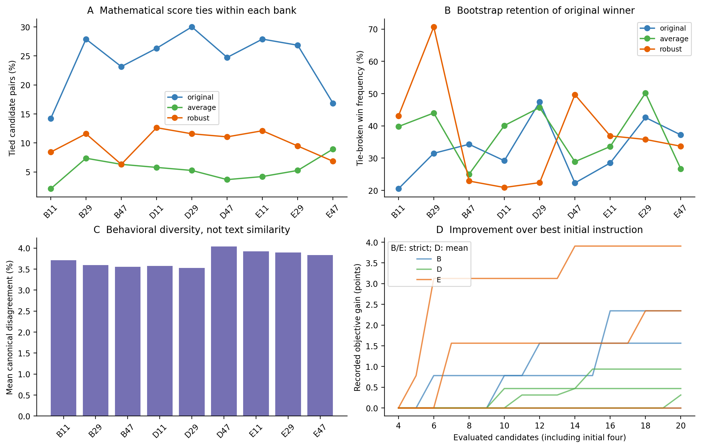
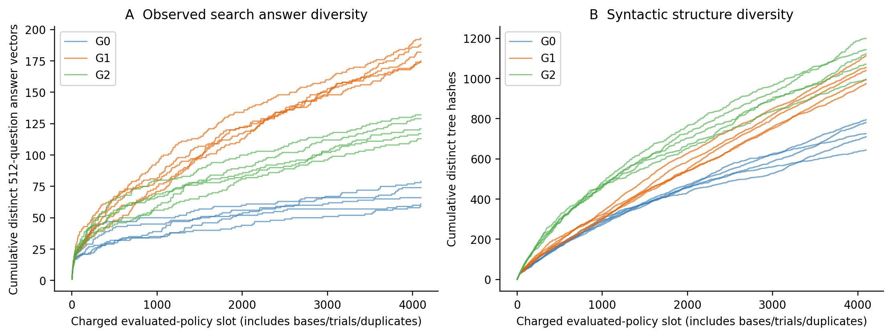
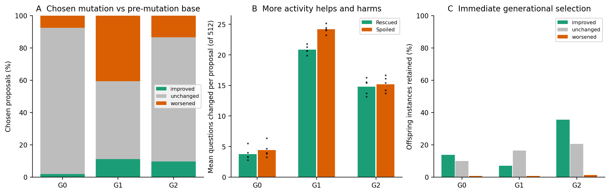

# Post-hoc mechanism analyses

Completed 2026-10-31T19:41:24.622063+08:00. These diagnostics use previously recorded experiments and reused development validation. They were not predeclared parts of the original studies. No model inference, new search, tuning or final-based policy selection was performed. The current Word report and all historical scientific files remain unchanged.

## 1. Study 1: modest behavioral differences and unstable rankings, not a universal tie problem

All 480 recorded candidate scores, 432 post-initial parent lists and 12 validation choices were reproduced. The nine matched B/D/E banks each contain 20 candidates: four initial instructions and only 16 further proposals (16 random in B; eight mutations/eight crossovers in D/E). C has 100 candidates per seed, with original-only search responses, and is excluded from matched five-format comparisons.

Both original and strict correctness have 129 possible counts on 128 questions; mean accuracy has 641 possible total-correct counts. Within the SAME nine banks, original scores occupied 4–7 values, strict scores 7–11 and mean scores 10–16. Mean pairwise tie rates were 24.21% original, 10.00% strict and 5.44% mean. Thus strict fitness was coarser than mean fitness in these records, but less tied than original accuracy. Between-method banks alone are not an objective ablation.

Ties reached actual decisions: E had 13/48 tied parent tournaments and 9/48 tied survival boundaries. One of three E shortlist boundaries was tied. Nevertheless, tie presence does not demonstrate that ties caused the final negative result. D's sequential floating-point summation split mathematically equal means; those historical orders and parents were reproduced exactly, not repaired. Detailed mathematical/float decision counts are in study1_selection_summary.csv.

Every matched bank had 20 distinct texts AND 20 distinct search answer vectors. However, average pairwise canonical disagreement within a bank was only 3.53–4.04% across its 640 responses. There was no exact behavioral collapse, but instructions were behaviorally close. Rescues, spoils and wrong-to-wrong changes are separately recorded for all 1,710 within-bank pairs; these correlated pairs are not independent evolutionary runs.

Across 1,000 paired whole-question bootstrap resamples per bank, the original mathematical strict-fitness winner retained the tie-broken win in 20.9–70.7% of resamples. Best-set membership and every candidate's win frequency are supplied separately. This supports ranking sensitivity on 128 search questions, not a statistical proof that one fitness caused failure. Bootstrap repetitions do not create extra independent search data.

Only three candidates per bank had validation responses. The original search winner was the validation choice in 1/9 matched banks. Only 2 positive best-initial-to-search-winner improvements had both validation endpoints available; 2 remained positive on the corresponding validation objective. Missing endpoints remain missing. This limited evidence does NOT support a blanket claim that search gains failed to transfer.

## 2. Study 2: a logical explanation for the identical answers

Seventeen actual frozen exports were checked: fixed voting, ordered stopping and all 15 evolved policies. Historical vectorized execution and an independent scalar evaluator agreed on all 53,125 policy-pattern cases. All 15 evolved policies exactly match the fixed triple's answer on all 1,024 all-valid canonical response patterns. 10/15 also match on all 3,125 patterns including invalid responses; five do not.

|Frozen method|Seeds|Different answers / 1,024 valid patterns|Different answers / 3,125 invalid-inclusive patterns|
|---|---|---:|---:|
|G0|11, 71|0|100|
|G0|29|0|12|
|G0|47, 101|0|0|
|G1|11|0|100|
|G1|29, 47, 71, 101|0|0|
|G2|11, 29, 47, 101|0|0|
|G2|71|0|100|

Counts are per policy. Uniform hypothetical patterns do not estimate real-world frequency. Ordered stopping matches fixed voting on the entire invalid-inclusive domain. For example, format responses `[-1,-1,-1,-1,0]` cause G0/seed11 to stop after querying formats 3 and 0 with failure, while fixed voting also queries format 4 and returns canonical answer 0. This is a logical answer difference, not a claim about which is correct without a label.

This result is stronger than equal rounded accuracy: for these frozen exports, adding questions whose five standard responses are valid cannot expose an answer-accuracy difference. Costs can still differ. Invalid cases can separate five policies. No claim is made about all policies in the class, new methods, a model ceiling, or a whole-search equivalence class.

Each of the 15 recorded searches consumed 4,096 charged evaluation slots, including bases, probes and duplicates. Median first appearance of the fixed triple's **observed 512-question search vector** was 406 slots for G0, 100 for G1 and 89 for G2. This is observed-data matching, not exhaustive equivalence of those intermediate structures. G0/G1 made 2,032 chosen mutations per seed; G2 made 551–580 because it paid for multiple trials. All 15 first reached the reference search vector, but other answer vectors continued appearing: the last new one occurred between slots 3852 and 4096. In 12/15 runs new structures appeared after the last new answer vector. The logs show structural redundancy, NOT complete early cessation of answer exploration.

## 3. Mutation activity, population filtering and limited transfer evidence

All 23,142 base/chosen-child joins passed exact rescue–spoil and utility accounting. A base may already include crossover, so these differences isolate the subsequent mutation, not the entire reproductive operation.

|Variant|Chosen mutations|Accuracy improved|Unchanged|Worsened|Mean rescued / spoiled|
|---|---:|---:|---:|---:|---:|
|G0|10,160|1.78%|90.61%|7.61%|3.77 / 4.41|
|G1|10,160|11.14%|48.16%|40.70%|20.85 / 24.19|
|G2|2,822|9.67%|76.86%|13.47%|14.80 / 15.19|

These pooled proportions are descriptive; per-seed results are supplied. G1 increased both beneficial and harmful changes, and rescued/spoiled many more questions per proposal. Its 55.88% answer-changing rate versus G0's 10.11% did not imply directional improvement. Balanced changes with zero net accuracy are separated from no answer changes in the detailed tables. Utility classifications use exact `100*correct − total_calls`; accuracy and utility improvements need not agree.

All 15 final ordered populations and score lists were reproduced using the historical deterministic survival function on recorded children. Immediate offspring-instance survival among accuracy-worsening proposals was 5/773 for G0, 29/4135 for G1 and 5/380 for G2. Most harmful mutations were rejected. Beneficial relative-to-base proposals were not guaranteed survival either: selection compares the whole population's accuracy/cost trade-offs. Rates condition on different proposal pools and do not establish one selector's causal superiority. Instance retention and mere presence of a duplicate policy hash are recorded separately.

G2 scored 6.20 trials per mutation on average. In 2521/2822 pools (89.3%), no trial improved base utility. Ranked selection chose a lower-utility mutant in 960/2287 cases; random exploration did so in 397/535. The normal trial constructor excludes the unchanged base; it appeared in only 57/2822 recorded pools, all within recorded random-fallback pools. Choosing the best offered mutant therefore did not ensure improvement over base. This is not a population-selection bug. Retaining the base when the chosen trial does not improve utility is supplied only as a local counterfactual, never a predicted alternative search trajectory. Missing discarded bodies prevent rechecking every size tie-break, although ranked utility and call tie-breaks were verified.

For development transfer, 20 evenly spaced body-available pairs per method/seed gave 300 pairs (600 validation policy replays), selected without validation outcomes. Missing base bodies excluded 211/10,160 G0, 366/10,160 G1 and 282/2,822 G2 pairs from eligibility; novel crossover bases need not have been archived. The deterministic sample is not an unbiased population sample.

|Variant|Sampled pairs|Positive search-accuracy changes|Persisted / disappeared / reversed on validation|
|---|---:|---:|---|
|G0|100|2|2 / 0 / 0|
|G1|100|8|7 / 0 / 1|
|G2|100|5|3 / 0 / 2|

Only 15 sampled pairs improved search accuracy: 12 gains persisted on reused validation and 3 reversed. Thus these records do NOT establish broad transfer failure or overfitting as the cause of the final null result. The sample has few positive cases, availability bias and reused validation. Per-seed paired accuracy, calls and utility changes are in validation_transfer_pairs.csv and validation_transfer_summary.csv.

## Evidence and remaining hypotheses

|Hypothesis|Analysis|Observation|Supported interpretation|What remains unresolved|
|---|---|---|---|---|
|Strict fitness failed because it was uniquely tied|Matched integer score counts and actual decisions|Strict ties exceed mean ties but are fewer than original ties; some affect tournaments/survival|Coarse discrimination exists; uniquely severe ties are not supported|A causal effect of changing only the objective/tie rule would need an intervention|
|Instructions lacked all behavioral diversity|Canonical vectors and pairwise changes|20 distinct vectors per bank, but only 3.53–4.04% average pairwise response disagreement|Behaviorally close candidates, not exact collapse|Whether different proposal mechanisms or deeper search would help|
|A 128-question winner is robustly ranked|Paired question bootstrap|Strict winner win frequencies span 20.9–70.7%|Ranking is sensitive to question composition in these banks|Future independent data/search variability|
|Search gains generally fail to transfer|Available shortlist endpoints and fixed mutation samples|Sparse Study 1 endpoints; 12/15 sampled positive mutation gains persist|No blanket transfer-failure explanation supported|Unvalidated candidates, many omitted bases and reused validation|
|Final equal accuracies are only a small-sample coincidence|Exhaustive frozen-policy logic|All 15 evolved answer functions match fixed voting on all-valid patterns|Logical equivalence explains identical answers under that domain|Invalid cases, other policies and different response pools|
|Whole search stopped exploring answers early|Every charged replay in order|New answers appear near the budget end; many more tree hashes than answer vectors|Structural redundancy with continuing answer exploration|Why selection ultimately preferred this answer function|
|More active mutation means better mutation|Base/child rescue, spoil and utility accounting|Both improvements and degradations rise strongly|Activity alone is not direction or final-policy improvement|An isolated causal explanation of final performance|
|Harmful proposals mean evolutionary selection is broken|Reconstructed instance survival|Most accuracy-worsening offspring are rejected|Proposal quality and population filtering must be separated|Longer-term descendant contributions and counterfactual trajectories|
|G2's best trial must beat its base|Recorded trial pools and choices|Most pools have no utility improvement; base usually absent|Best-of-mutants can be worse than base|Whether adding base retention would improve a full rerun; none was run|

## Scope and limitations

These are post-hoc diagnostics of fixed banks and already inspected outcomes. No new model calls, search, selection, held-out data or causal intervention. Whole-question bootstrap is conditional on a candidate bank; correlated mutations/pairs are not extra independent evolutionary runs. Discarded bodies are missing for many scored hashes, but their observed answer vectors remain valid for descriptive convergence. Survival reconstruction concerns immediate instances, not later descendants. The final 79.2% and 2.204-call reference remain unchanged. No overall model capability ceiling or universal failure of robustness/evolution is inferred.

Detailed tables and checkpoints are supplementary; provenance.json and results/verification files record input hashes, zero inference and preservation. The original report/Word file was not edited.
